# ToknMon

[](https://github.com/edgarbaldemarmx/toknmon/actions/workflows/ci.yml)
[](LICENSE)


<p align="center">
  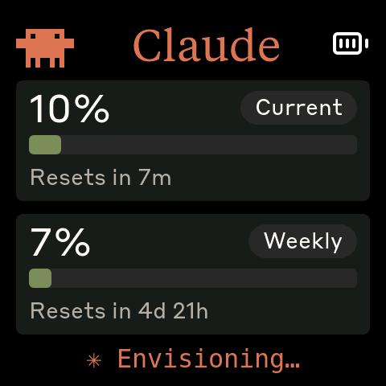
</p>

**ToknMon** is a desk-side usage meter for AI coding assistants. A pocket-size
ESP32-S3 board with a round-cornered AMOLED shows the rate-limit windows of
**Claude Code**, **OpenAI Codex CLI**, **Kimi Code** and **Grok Build CLI** side by side, each
with its own colors and pixel-art mascot, fed over Bluetooth by a small daemon
on your Mac. The meter stays on screen until you touch it; a tap, swipe or
long-press brings up the animations.

It is a fork of [Clawdmeter](https://github.com/HermannBjorgvin/Clawdmeter) by
Hermann Bjorgvin, which monitors Claude Code only. ToknMon adds the
multi-provider daemon, the per-provider screens and mascots, mascot mode, the
parade, gesture navigation, a configurable Bluetooth name and the tooling to
draw your own animations as text. It is a personal project: issues and pull
requests are welcome, support is best-effort.

## Contents

- [Features](#features)
- [Animation gallery](#animation-gallery)
- [Supported hardware](#supported-hardware)
- [Requirements](#requirements)
- [Quick start](#quick-start)
- [Using the device](#using-the-device)
- [Providers](#providers)
- [Configuration](#configuration)
- [Customizing animations](#customizing-animations)
- [Serial QA commands](#serial-qa-commands)
- [Troubleshooting](#troubleshooting)
- [Development](#development)
- [Roadmap](#roadmap)
- [Credits](#credits)
- [License](#license)

## Features

| | |
| --- | --- |
| 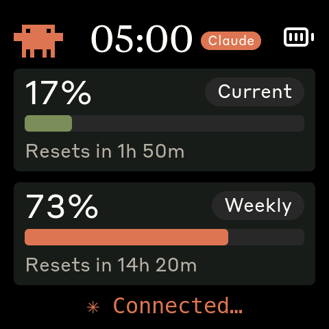 | **Four providers, one carousel.** Claude Code (5-hour session and weekly bars, plus the model-scoped **Fable** weekly window on its own page of small Clawds when your plan has one), Codex CLI, Kimi Code and Grok Build CLI each get a slot. Tap or swipe to page; it stays on the provider you picked, even after a reboot. Paging skips slots without fresh data. |
| 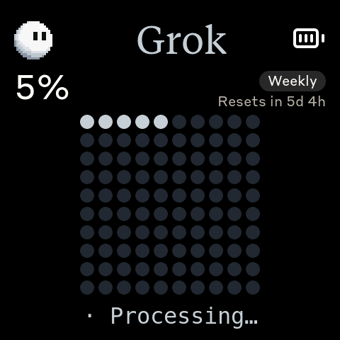 | **A screen per provider.** Codex shows a 10×10 dot grid filling to the weekly percentage (plus a compact 5h bar when the plan has one); Grok shows its weekly credit window on a silver dot grid; Kimi shows 5h and weekly bars in blue; Claude keeps its bars in clay. Palettes, bar tiers and status lines never bleed between providers. |
| 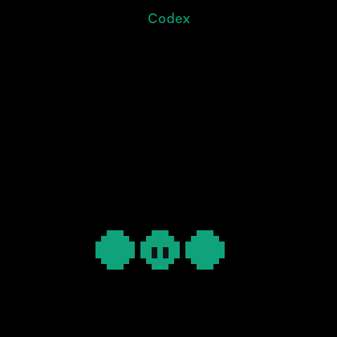 | **Mascots and mascot mode.** Clawd for Claude (Anthropic's official set), original three-dots, crescent-moon and Grokbot-style ball characters for Codex, Kimi and Grok, each with idle, acts, a mountain-bike ride and two full-screen scenes. Long-press the meter to watch a provider's set full-size. |
| 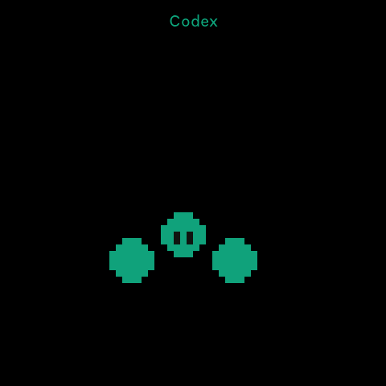 | **The parade.** The device rotates every live provider's full-size mascot every 20 s, until you swipe back. It never starts on its own (serial `parade on`). |
| 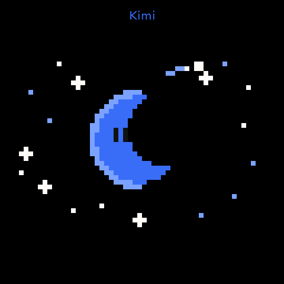 | **Draw your own.** Animations are plain text grids compiled by a small Node tool. The Codex and Kimi scenes were authored by an AI agent from a two-sentence brief. |
| 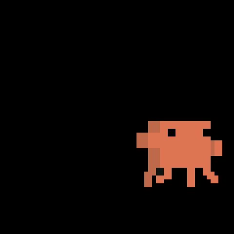 | **Quiet by design.** No cloud, no accounts of its own: the daemon reads the tokens your CLIs already have (Claude Code, Kimi) or local logs (Codex), polls once a minute with no token spend, and pushes ~150 bytes per provider over BLE. The side buttons double as Bluetooth keyboard keys for Claude Code (Space, Shift+Tab). |

Also: configurable Bluetooth name per board (several on one desk), optional
clock and session-reset chime, Claude Code attention alerts (the mascot waves
when a session waits for you), a desktop simulator for development, and a
serial command set for hands-free QA.

## Animation gallery

Every custom animation, exported straight from the text grids at six pixels
per cell ([`docs/media/README.md`](docs/media/README.md)).

| Provider | Idle | Act | Think / sleep | Bike | Scene 1 | Scene 2 |
| :--- | :---: | :---: | :---: | :---: | :---: | :---: |
| **Claude** | <br>official Clawd set (17 animations: core poses and persona scenes, not redistributed here) | — | — | 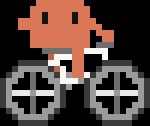 | — | — |
| **Codex** |  | 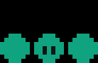 |  | 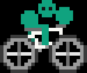 |  | 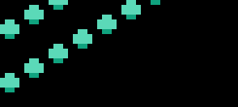 |
| **Kimi** | 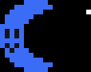 | 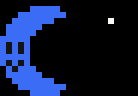 | 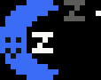 | 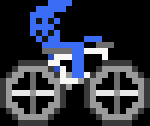 | 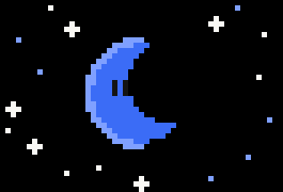 | 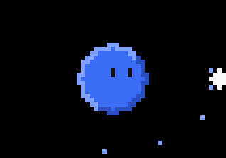 |
| **Grok** | 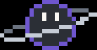 |  | — |  | 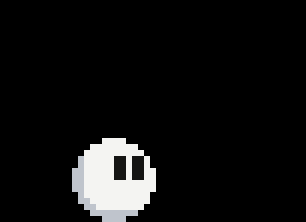 |  |

On the device the scenes fill the 480×480 panel:

| | |
| :---: | :---: |
| 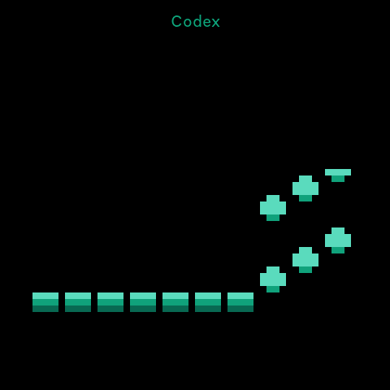 | 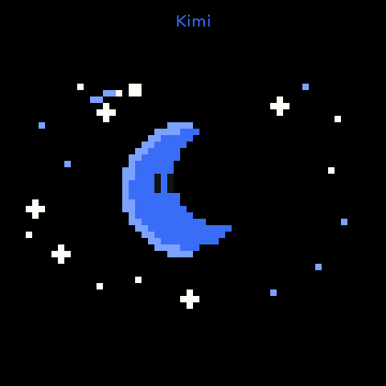 |
| `codex.scene.rain` (simulator) | `kimi.scene.night` (hardware) |

## Supported hardware

| Board | PlatformIO env | Status |
| --- | --- | --- |
| [Waveshare ESP32-S3-Touch-AMOLED-2.16](https://www.waveshare.com/esp32-s3-touch-amoled-2.16.htm) — 480×480 CO5300 AMOLED, CST9220 touch, AXP2101 PMU, QMI8658 IMU, ES8311 codec | `waveshare_amoled_216` | ✅ **verified** — the board ToknMon is developed and tested on |
| Waveshare ESP32-S3-Touch-AMOLED-1.8, ESP32-S3-Touch-AMOLED-2.06, ESP32-C6-Touch-AMOLED-2.16 / 1.8, ESP32-S3-Touch-LCD-1.54, ESP32-S3-Touch-LCD-4 | `waveshare_amoled_18`, `waveshare_amoled_206`, `waveshare_amoled_216_c6`, `waveshare_amoled_18_c6`, `waveshare_lcd_154`, `waveshare_lcd_4` | ⚠️ **inherited from Clawdmeter, untested with ToknMon.** They compile in CI, but nobody has run the multi-provider UI, mascots or gestures on them since the fork. The C6 boards have no PSRAM: no corner mascots, no dot grid, no `screenshot` command. Reports welcome. |

**Host**: macOS only. The Linux and Windows daemons in `daemon/` are inherited,
Claude-only and untested with ToknMon.

Porting to another board means a new folder under `firmware/src/boards/` and a
PlatformIO env; shared code never changes. See
[`docs/porting/adding-a-board.md`](docs/porting/adding-a-board.md).

## Requirements

**Host (macOS)**

- macOS 13 (Ventura) or newer with Bluetooth.
- Python 3.10 or newer (3.13 is what the project runs on). The installer
  creates its own virtual environment.
- [PlatformIO CLI](https://docs.platformio.org/en/latest/core/installation/index.html)
  to build and flash: `brew install platformio` or `pip install platformio`.
  A pip/installer-script install puts `pio` at `~/.platformio/penv/bin/pio`:
  add that to `PATH`, or let the scripts find it there.
- A USB-C **data** cable.
- Optional: `blueutil` (`brew install blueutil`) for automatic stale-bond
  repair; Node 18+ and ImageMagick (`brew install node imagemagick`) only if
  you want to draw animations or regenerate previews; SDL2 (`brew install sdl2`)
  for the desktop simulator.

**Accounts and CLIs** (enable any subset; the daemon detects what is present)

| Provider | What must exist on the Mac |
| --- | --- |
| Claude Code | logged in (`claude` → `/login`): the OAuth token lives in the Keychain (service `Claude Code-credentials`) |
| Codex CLI | at least one session so `~/.codex/sessions/` has a `rollout-*.jsonl` from the last 7 days; no credentials are read |
| Kimi Code CLI | logged in once so `~/.kimi-code/credentials/` has a token file; the daemon refreshes the token itself afterwards |
| Grok Build CLI | logged in (`grok login`) so `~/.grok/auth.json` holds a token; the daemon refreshes it afterwards the way Grok does, under Grok's own `auth.json.lock` |

> **Clone location.** launchd runs the daemon from the Python inside
> `daemon/.venv`. If the clone lives under `~/Documents`, `~/Desktop` or
> `~/Downloads`, macOS privacy controls can hang the agent at startup until you
> grant that Python access under **System Settings → Privacy & Security →
> Files and Folders**. Cloning to `~/toknmon` avoids the question.

## Quick start

1. **Clone**

   ```bash
   git clone https://github.com/edgarbaldemarmx/toknmon.git ~/toknmon
   cd ~/toknmon
   ```

2. **Connect the board by USB and flash it**, giving it a Bluetooth name
   (1–18 printable ASCII characters, no `#`). The first build downloads the
   toolchain and takes a few minutes.

   ```bash
   ./flash-mac.sh waveshare_amoled_216 --name "<Your name>"
   # ./flash-mac.sh waveshare_amoled_216 /dev/cu.usbmodem1101 --name "<Your name>"   # explicit port
   ```

   The script builds, uploads, sets the name over serial and saves it as
   `device_name` for the daemon. Rename later without reflashing:
   `./flash-mac.sh --rename "<New name>"`. Details: [`docs/flashing.md`](docs/flashing.md).

3. **Pair** the board: **System Settings → Bluetooth → Connect** next to the
   name you chose. While unpaired the board stays on the splash animation.
   (After a rename, unpair and pair again: macOS caches the name with the
   bond.)

4. **Install the daemon**

   ```bash
   ./install-mac.sh                                                              # interactive
   # ./install-mac.sh --yes --providers auto --device-name "<Your name>" --no-prime  # non-interactive
   ```

   It creates `daemon/.venv`, writes `~/.config/toknmon/config`, installs the
   launchd agent `com.toknmon.daemon` and runs the daemon once so macOS asks
   for Bluetooth permission (accept it) unless you pass `--no-prime`, in
   which case run the printed command once manually. Logs go to
   `~/Library/Logs/toknmon.{out,err}.log`. Upgrading from Clawdmeter is
   automatic: the legacy agent is retired and the old config copied.
   Details: [`docs/install-macos.md`](docs/install-macos.md).

5. **Choose providers.** The installer prints which providers it detected and
   how to enable the missing ones. The default `providers = auto` re-detects
   on every poll, so logging in to a new tool is picked up within a minute;
   set an explicit list in `~/.config/toknmon/config` to pin it.

Within a minute the board leaves the splash and shows your first provider.
Swipe up or down to move between the splash and the meter.

## Using the device

The board boots on the **splash** (animations) and swipes to the **meter**
(usage). Full reference: [`docs/controls.md`](docs/controls.md).

| Input | On the splash | On the meter |
| --- | --- | --- |
| **Tap** | next animation | next provider |
| **Swipe up / down** | go to the meter | go to the splash |
| **Swipe left / right** | next / previous animation | next / previous provider |
| **Long-press** | — | **mascot mode** for the provider on screen |
| **PWR button** (middle) | next animation | cycle brightness |
| **PWR held ~3 s, then released** | pairing mode (clears the bond, advertises again) | same |
| **BOOT button** (left) | hold: **Space** over Bluetooth HID (Claude Code push-to-talk) | same |
| **Secondary button** (right) | **Shift+Tab** over Bluetooth HID (Claude Code mode toggle) | same |

- **Carousel**: the meter stays on the provider you picked (tap or swipe to
  page; the pick survives a reboot); a slot is live for 90 s after its last
  payload and paging skips it otherwise.
- **Mascot mode**: the provider's full-size set plays in order (Codex: idle,
  dots, think, bike, wave, rain; Kimi: idle, glow, sleep, bike, night, orbit;
  Grok: idle, look, bike, stars, build; Claude: the official set) with the provider's name on top; tap, swipe
  sideways or PWR to step; swipe vertically to return.
- **Parade**: every live provider's mascot gets 20 s on stage in turn; a
  vertical swipe ends it. It never starts on its own: the meter stays up
  until you touch it (serial `parade on` starts it).
- **Attention alerts**: with the Claude Code hooks installed
  ([how](docs/install-macos.md#attention-alerts-from-claude-code-optional)),
  Clawd walks on and waves when a session waits for you.

## Providers

| Provider | Source | Screen |
| --- | --- | --- |
| **Claude Code** | `GET https://api.anthropic.com/api/oauth/usage` with the Claude Code OAuth token — one request per poll, no token spend | Current (5h) and Weekly bars, and a **Fable** view (a grid of small Clawds) when the subscription reports a model-scoped window |
| **Codex CLI** | the newest `rate_limits` entry in `~/.codex/sessions/**/rollout-*.jsonl` (last 7 days) — local files, no network | 10×10 dot grid for the weekly window, large percentage and reset time; compact 5h bar only when the plan has one |
| **Kimi Code** | `GET https://api.kimi.com/coding/v1/usages` with the token from `~/.kimi-code/credentials`; expired tokens are refreshed through `https://auth.kimi.com/api/oauth/token` and written back like the CLI does | 5h and weekly bars |
| **Grok Build CLI** | `GET https://cli-chat-proxy.grok.com/v1/billing?format=credits` with the access token from `~/.grok/auth.json`; an expired token is refreshed through `https://auth.x.ai/oauth2/token` and written back like Grok does; when the call still fails, the newest billing line in `~/.grok/logs/unified.jsonl` if it is under 6 h old | 10×10 dot grid for the weekly credit window (Grok has no 5h window) |

**Detection.** With `providers = auto` (the default) the daemon checks on every
poll which providers are usable, locally and without network: a Claude Code
OAuth token in the Keychain or `.credentials.json`, a `rollout-*.jsonl` under
`~/.codex/sessions`, a credential file under `~/.kimi-code/credentials`, a
token in `~/.grok/auth.json`. It
sends only those and logs the set whenever it changes (`Providers (auto):
claude, codex — kimi skipped: …`). The installer prints the same report with
instructions for anything missing, and
`daemon/.venv/bin/python daemon/claude_usage_daemon.py --detect` prints it on
demand. A provider that has no data this cycle sends
`{"p": "<id>", "ok": false}` and its slot drops out of the carousel after 90 s
without affecting the others.

**Adding or removing.** Log in to (or run once) the tool and keep `auto`, or
write an explicit list such as `providers = claude, codex`. Payload keys
(`p, s, sr, w, wr, f, fr, st, ok, …`) and the per-provider details are in
[`docs/providers.md`](docs/providers.md).

## Configuration

`~/.config/toknmon/config` is a flat `key = value` file (`#` starts a comment),
re-read on every poll, so edits take effect within about a minute. All keys
are documented in [`daemon/config.example`](daemon/config.example).

| Key | Default | Meaning |
| --- | --- | --- |
| `providers` | `auto` | `auto`, or a comma-separated subset of `claude, codex, kimi, grok` |
| `device_name` | `ToknMon` | the board's Bluetooth name as set when flashing; used by the HID fallback and stale-bond repair (the legacy names `TokenMon` and `Clawdmeter` are also accepted) |
| `chime` | `off` | `on` plays a chime on the board when the Claude 5-hour session resets |
| `beep` | `off` | `on` beeps when a Claude Code attention alert arrives |
| `clock` | `off` | `auto`, `12` or `24` shows a clock in place of the "Usage" title |
| `config_dirs` | `~/.claude` | comma-separated Claude config dirs (`CLAUDE_CONFIG_DIR` setups); the plan whose usage rose most recently is shown |
| `kimi_token_url` | `https://auth.kimi.com/api/oauth/token` | OAuth endpoint for the Kimi token refresh (HTTPS only) |
| `poll_interval`, `heartbeat_interval` | `60`, `60` | polling and heartbeat periods — **read by the inherited Linux daemon only**; the macOS daemon polls every 60 s |

## Customizing animations

Every Codex and Kimi animation is a text file under `assets/animations/`: a
palette legend, a few header keys and one character per cell, with `---`
between frames. A Node script compiles them into the firmware and can export
PNG strips and GIFs:

```bash
node tools/convert_grid_animations.js                 # → firmware/src/custom_animations.h
node tools/convert_grid_animations.js --verify DIR    # PNG frame strips to check your art
node tools/convert_grid_animations.js --gif DIR       # looping GIFs like the gallery above
pio run -d firmware -e waveshare_amoled_216 -t upload # flash
```

Rules: feet on the stage's bottom row, at most 15 colors plus transparent,
corner mascots inside 28×21 cells, scenes up to 55×37. Wire a new animation
into a provider's play-list by name in `firmware/src/splash.cpp`. The
format, the rules the converter enforces and the workflow for having an AI
agent draw a scene from a short brief (how the four scenes above were made)
are in [`docs/animations.md`](docs/animations.md).

## Serial QA commands

The firmware answers commands on the USB serial console (115200 baud), so
every screen can be reached without touching the board:

```text
screen usage | screen splash [claude|codex|kimi|grok]   slot 0-3   next
splash next|prev   swipe up|down|left|right   parade on|off
name [text]   screenshot   buzz
```

`./screenshot.sh out.png [port] [--screen usage|usage:<provider>|splash:<provider>]`
captures a 480×480 PNG, switching screens (and provider slot) first if asked,
and retries the transfer up to 3 times when BLE traffic stalls it. Full table in
[`docs/controls.md`](docs/controls.md#serial-qa-commands).

## Troubleshooting

The most common ones; the full list is in
[`docs/troubleshooting.md`](docs/troubleshooting.md).

| Symptom | Fix |
| --- | --- |
| Daemon never gets past startup | The clone is under `~/Documents` (or similar): grant the venv's Python access under Privacy & Security → Files and Folders, or move the clone to `~/toknmon` |
| Board missing or wrongly named in Bluetooth after a rename | Unpair and pair again; macOS caches the name with the bond |
| Two daemons fighting over the board | A Clawdmeter-era agent is still loaded: `./install-mac.sh` retires it, or `launchctl bootout gui/$(id -u)/com.user.claude-usage-daemon` |
| Kimi slot stays empty | Log in once with the Kimi Code CLI; the daemon refreshes the token from then on |
| Codex slot stays empty | Run Codex once; logs older than 7 days are ignored |
| Grok slot stays empty | Run `grok login`: the stored sign-in was rejected (`invalid_grant`), so the daemon cannot refresh the token any more |
| `No /dev/cu.usbmodem* found` when flashing | Data cable, other USB-C port, or pass the port explicitly |

## Development

```bash
pio run -d firmware -e sim && (cd firmware && .pio/build/sim/program)   # desktop simulator (SDL2)
daemon/.venv/bin/python -m pytest daemon/tests -q                       # daemon tests
node --test tools/test/ && bash tools/test/shell/test_device_name_validator.sh
bash tools/test/shell/test_sim_sticky_view.sh                           # sticky usage view (needs the sim build)
pio run -d firmware -e waveshare_amoled_216                             # firmware
```

The simulator runs the full firmware loop in an SDL2 window with scenario
playback and headless captures ([`docs/simulator.md`](docs/simulator.md)).
CI builds the simulator and the 2.16 firmware and runs every test on each
push. Project layout, release flow and conventions:
[`docs/development.md`](docs/development.md); contributions:
[`CONTRIBUTING.md`](CONTRIBUTING.md).

```text
firmware/   PlatformIO project: src/ (main, ui, splash, ble, theme, hal/, boards/<name>/), sim/ scenarios
daemon/     macOS daemon (claude_usage_daemon.py, providers/, launchd template, tests/)
assets/     animation text grids, font and icon sources
tools/      converters (grid → header, official Clawd → header, PNG → LVGL), gallery script, tests
docs/       guides (install, flashing, providers, controls, animations, troubleshooting, simulator, development),
            porting/, media/ (screenshots, GIFs), odd/ (design log H0–H8)
```

## Roadmap

- Verify the inherited boards (AMOLED 1.8 / 2.06, C6 variants, LCD 1.54 / 4)
  with the multi-provider UI, or drop the ones nobody tests.
- Linux and Windows daemons with the provider model (today they are
  Clawdmeter's Claude-only versions).
- More providers (Gemini CLI, Cursor, local models) and a provider-aware
  attention alert.
- Reactive animations: mascots that react to usage pace and resets for Codex
  and Kimi the way Clawd does for Claude.
- Releases with prebuilt firmware images.

## Credits

- [Clawdmeter](https://github.com/HermannBjorgvin/Clawdmeter) by
  [Hermann Bjorgvin](https://github.com/HermannBjorgvin): the firmware
  architecture, board ports, splash engine, simulator, converters and the
  original daemons. The macOS host pieces were contributed upstream by
  [Chris Davidson](https://github.com/lorddavidson).
- **Clawd** pixel art and the Tiempos Text / Styrene B fonts are Anthropic's
  (see [License](#license)).
- Firmware libraries: [LVGL](https://lvgl.io), [NimBLE-Arduino](https://github.com/h2zero/NimBLE-Arduino),
  [ArduinoJson](https://arduinojson.org), [GFX Library for Arduino](https://github.com/moononournation/Arduino_GFX),
  [XPowersLib](https://github.com/lewisxhe/XPowersLib), [SensorLib](https://github.com/lewisxhe/SensorLib),
  [pioarduino](https://github.com/pioarduino/platform-espressif32); [Lucide](https://lucide.dev) icons.
- Host libraries: [bleak](https://github.com/hbldh/bleak), [httpx](https://www.python-httpx.org).
- [Waveshare](https://www.waveshare.com) for the ESP32-S3 Touch AMOLED boards.
- The Codex and Kimi scenes were drawn by Kimi K3 through the grid pipeline.

## License

ToknMon's code, scripts, documentation and original pixel art are released
under the **MIT License** ([`LICENSE`](LICENSE), © 2026 Edgar Ramos).

**Read [`NOTICE.md`](NOTICE.md) before redistributing.** The repository bundles
assets that are **not** covered by that license and are used without one, in
the same posture as upstream Clawdmeter (which publishes no license): the
official Clawd mascot animations, the Claude Code logo, and the generated
Tiempos Text and Styrene B font data, all Anthropic's property. The Codex,
Kimi and Grok mascots are original art, not official brand assets; "Codex",
"Kimi" and "Grok" are trademarks of their respective owners and are used only to name the
monitored services. Fork and flash for personal use with that in mind.
